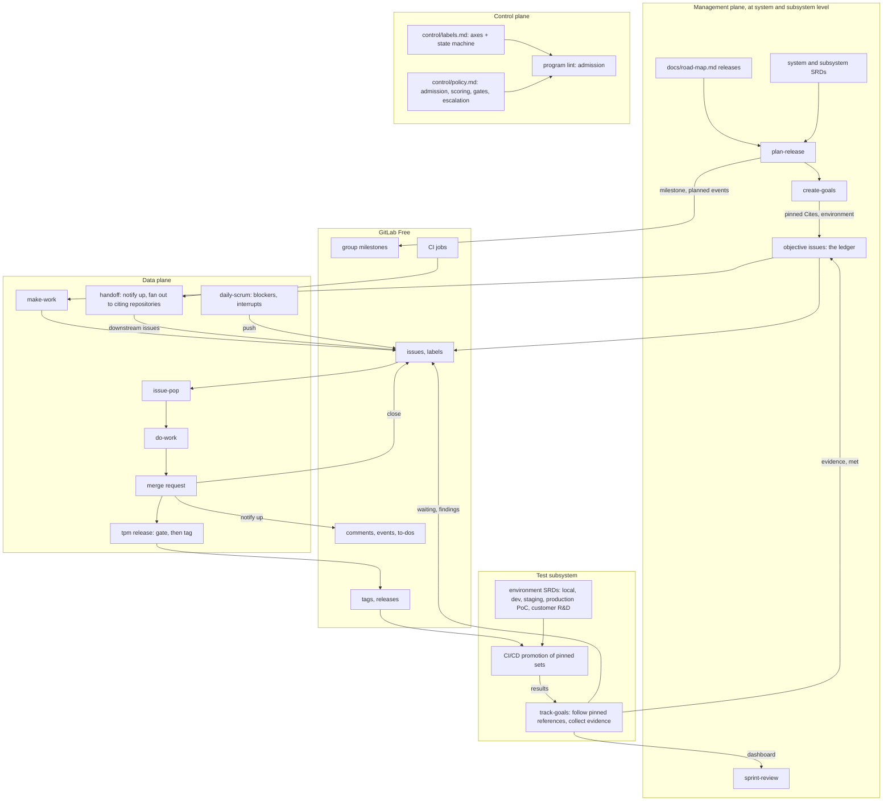

<!-- field: overview -->
## Overview

<!-- field: summary -->
### Summary

The process is three planes over one tracker, repeated at every level of
a program. The management plane sets intent once per three-week period:
the next release at each level and the objectives each level pushes to
the level below. The control plane holds the rules an issue moves by, as
policy files under version control. The data plane is the work: issues
popped, built, merged, released, promoted through environments, and
handed on. Intent and rules flow down, evidence flows up, and all of it
is tracker state or a tagged file.

A program has levels, and each has one owner. The system level belongs
to the technical program manager, who writes system SRDs, interface
YAMLs, and the subsystem SRDs that declare each subsystem's owner and
components. Each subsystem belongs to a Product Owner, who writes the
requirements that satisfy the objectives pushed to it. Components belong
to Developers. The test subsystem belongs to the Scrum Master, who
specifies its environments, pipelines, and suites as SRDs. Every
repository at every level carries the same docs/ corpus, and
repositories reference each other only by URLs pinned to release tags.

Every object is an issue or something attached to one. An objective is
an issue whose comment events are its ledger: planned, evidence, met. A
sprint is a milestone and a sprint issue. An epic is an issue with a
list of member issues. A recurring issue is a subscription to an
artifact or an audit. A dependency is a link line in an issue body. A
release is a tag that handoff reads and that the test subsystem
promotes. The five label axes (plane, type, kind, component, state)
make an issue self-describing.

Done is evidence. An acceptance criterion names the test that proves it
and the environment where that proof counts; an objective is met when
those tests pass there on a recorded pinned set, and track-goals, the
nightly audit, records the evidence and closes the objective. The
environments form one chain, local, dev, staging, production PoC, and
customer R&D, with promotion as CI/CD in the test subsystem and handoff
to a customer as a human approval. The test software ships with every
release.

Skills implement the process in two loops. The inner loop is the same
for every role and every kind of work: make-work turns a plan into
issues, issue-push files an issue in do-work's input format with the
plane that says whether it is project work or a requirements change,
issue-pop takes it into its own branch and worktree, do-work builds it
against its Requirements and Acceptance Criteria, a merge request closes
it, and tpm release tag tags a release once its gate passed. On GitLab, issue-push and
issue-pop are commands in this repository over tpm (srd035, srd036,
release 00.0); do-work and sub-issues arrive with epics later. The outer loops are the five Scrum
skills (srd020 to srd033): each reads the tracker, asks people bounded
questions, and pushes issues or posts ledger events.

Facts come from subcommands of the tpm CLI, a single Go binary; "script"
below means such a subcommand. Scripts are deterministic, idempotent,
reach the tracker through the GitLab Go client, and never ask a person
anything.

<!-- field: layer_diagram -->
### Layer diagram

<!-- field: loop_flow | form: "tree" -->
### Loop flow

- period_start:
  Before each three-week period the technical program manager runs
  plan-release in the system repository: the requirements the next system
  release proves go into the road-map through a reviewed merge request,
  and the milestone exists. create-goals then pushes one objective to each
  subsystem owner and one to the test subsystem, each citing its system
  requirements pinned to the release tag and naming its environment. Each
  Product Owner writes requirements that satisfy their objectives with
  do-work, runs plan-release for the subsystem, and, with downstream
  repositories, create-goals for them. Developers turn each subsystem plan
  into issues with make-work.
- evidence:
  Merge requests run component tests in the local environment as
  evidence. A subsystem release tag starts the test subsystem's pipelines:
  the pinned set installs fresh in dev, upgrades in staging, then upgrades
  in the production PoC, each step only on passing suites and on the
  trigger the receiving environment declares. track-goals runs nightly,
  follows pinned references from the system repository, posts each result
  as an evidence event on the objective it proves, and closes the
  objective with a met event when every requirement's latest evidence in
  its environment passed. Missing evidence or an unresolved reference fails
  the audit.
- artifact_release:
  A producing issue closes by merge request; handoff posts a done comment
  on its upstream issue. The producer files a release issue;
  tpm release tag tags it once the gate's evidence passed. CI on the tag
  runs handoff: for each recurring subscription or each repository citing
  the artifact's interface, a breaking release creates an unassigned
  consume issue or marks the subscription needs-run; a compatible release
  posts a comment.
- customer_handoff:
  A system release whose system tests passed in the production PoC waits
  for a person's approval on the system release issue. With it, the pinned
  set and its test-subsystem release go to the customer R&D environments.
- morning:
  daily-scrum fetches the person's in-progress issues, the overnight
  evidence findings on their objectives, and what is waiting, with a
  scored plan. It asks about blockers and interrupts and pushes an issue
  for each. The person takes a ready issue with issue-pop.
- weekly:
  The sprint update and the stakeholder update are recurring audit issues:
  each is popped, worked by do-work from tpm standup and tpm reports
  output, closed by merge request, and re-created for the next week.
- period_end:
  sprint-review shows each objective's ledger state and evidence; the
  Product Owner accepts the Increment or not and follow-up items are
  pushed. Then sprint-retrospective reads the period's audit metrics and
  pushes at most three plane::control issues, worked by the inner loop,
  that change the policy for the next period.
- upstream_signal:
  A consumer finds the artifact wrong or insufficient. Information goes as
  a comment on the producing issue. Work goes as a defect or request issue
  in the producer's project, which the producer triages and may decline.

<!-- field: interfaces -->
## Interfaces

<!-- interface: tracker -->
### tracker

GitLab Free through the glab CLI and the REST and GraphQL APIs. The only persistent state the process has.

It reads issues with their labels, assignee, milestone, description, and
sub-issues; related-issue links; comments and the current user's to-do
list; merge requests and the issues they close; tags and releases; and
group activity: pushes, merges, and time logged. It writes issues and
sub-issues; labels, the assignee (by issue-pop only), and the milestone;
comments carrying a machine marker, including ledger events; related-issue
links; and time tracking entries.

<!-- interface: policy_files -->
### policy_files

Versioned YAML under the system repository's control/ directory, read by the control-plane scripts. Changed only by merge request. The files are control/labels.md and
control/policy.md.

<!-- interface: repository_corpus -->
### repository_corpus

What every repository of a consuming program carries, at every level (design.md D7). The process reads it and never defines its content. It is docs/road-map.md,
the repository's releases and the requirements each proves;
docs/specs/software-requirements/, the repository's SRDs, which in the
system repository include the subsystem SRDs and in the test-subsystem
repository the environment SRDs; and docs/constitutions/design.md, the
shared conventions.

<!-- interface: person_inputs -->
### person_inputs

Per-person configuration, outside every repository: a per-person config
declaring tracker host, group, and the system repository.

<!-- interface: issue_body_conventions -->
### issue_body_conventions

Lines the scripts read from an issue description: `Upstream: <project>#<iid>`,
the issue that produced the artifact this issue consumes;
`Requires: <artifact> >= <version>`, a release this issue waits on;
`Cites: <url pinned to a tag>#<anchor>`, an upstream requirement or
interface; `Environment: <name>`, where an objective's evidence counts; the
`## Requirements`, `## Acceptance Criteria`, and `## Design Decisions`
sections, do-work's input; the `## Downstream` section, the artifacts this
issue's merge produces and who should review them;
`<!-- handoff: <project>!<mr> -->`, the idempotency marker on a generated
issue; and `<!-- tpm program event=<name> ... -->`, the marker on an event
comment.

<!-- field: components -->
## Components

<!-- component: management_plane -->
### management_plane

Set intent once per three-week period at each level and read the result as evidence. Never touches an individual work issue.

The management plane writes releases, requirements, and objectives. It does not write, move, or assign work, and never declares an objective met; evidence does.

<!-- field: capabilities -->
#### Capabilities

- plan-release: the requirements the next release proves, at system or subsystem level; road-map entry, milestone, planned events
- create-goals: one objective per downstream owner and release, citing requirements pinned to the release tag, naming its environment
- sprint-review: the Product Owner's verdict on the Increment against evidence; pushes follow-up items

<!-- field: ownership -->
#### Ownership

- docs/road-map.md in each repository
- system and subsystem SRDs
- objective issues and their ledgers

<!-- component: control_plane -->
### control_plane

Hold the rules an issue moves by, as data, and evaluate them. Changed by reviewed merge request; the data plane runs on the last version.

Changed by sprint-retrospective, the Scrum event whose output is plane::control issues proposing changes to these files, each worked by the inner loop and merged by reviewed merge request like any other work.

Rules live in files, not in script code. A rule change is a plane::control issue and a merge request, reviewed by a lead.

<!-- field: capabilities -->
#### Capabilities

- label schema: the five axes; component values from subsystem SRDs (control/labels.md)
- state machine: legal transitions over the state axis and who may fire each
- routing: consumers per artifact, from recurring subscriptions and repositories citing it by pinned URL
- admission: what an issue must carry, including tests and environments on criteria and pinned Cites lines (program lint)
- gates: the checks per artifact, each in a named environment (control/policy.md definition_of_done)
- dependency resolution: waiting, unblocked, and cycles from Upstream, Requires, and Cites lines (track-goals)
- escalation: evidence-age, blocker-age, and slip thresholds that surface on the dashboard
- event vocabulary: the comment markers scripts may post, including the ledger events

<!-- component: data_plane -->
### data_plane

Do the work. Continuous flow, pull only, headless when the management plane is absent.

Its objects are the issue, a commitment with component, kind, plane, and
milestone, and sub-issues for its units; the objective, an issue citing
pinned requirements and naming an environment, whose events are its ledger;
the epic, type::epic, a list of member issues that is never popped; the
recurring issue, type::recurring, a subscription to an artifact that runs
on breaking releases; the comment event, a message rather than a
commitment, carrying a machine marker, whose mentions create to-dos; and
the link: Upstream to an issue, Requires to a release, Cites to a pinned
requirement or interface.

Only issue-pop assigns. Only a person files an upstream defect or request. Only a merge, a person's decline, or track-goals on a met objective closes an issue.

<!-- field: capabilities -->
#### Capabilities

- make-work: turn a planned release into issues for its components
- daily-scrum: in-progress items, overnight evidence findings, waiting items; pushes blocker and interrupt issues
- issue-push: file an issue, with the Downstream section when it produces a shared artifact
- issue-pop: take an issue into a worktree, splitting it into sub-issues when needed
- do-work: build each unit against its Requirements and Acceptance Criteria; one merge request closes the issue
- tpm release: gate an artifact on its declared checks and tag it once the evidence passed (srd015)
- handoff: on merge, notify upstream; on release, fan out to citing repositories and comment on subscriptions
- audits: recurring issues for regression tests, contract checks, and the sprint and stakeholder updates

<!-- component: test_subsystem -->
### test_subsystem

Produce the evidence that decides done, and ship the means to reproduce it. Owned by the Scrum Master and specified as SRDs in its own repository, like any other subsystem.

Promotion is automation, not a skill. Handoff into a customer R&D environment is a person's approval. The test-subsystem release ships with every release so the customer can run the same suites.

<!-- field: capabilities -->
#### Capabilities

- environment SRDs: local, dev (fresh install), staging (one subsystem upgraded on a running system), production PoC (same upgrade path), customer R&D environments; each with owner, trigger, and suites
- pipelines: CI/CD that promotes a pinned set to the next environment when every suite of the current one passed, on the trigger the receiving environment declares
- suites: component, subsystem, system, and contract tests, with known-good and known-bad sets that test the tests
- track-goals: the audit that follows pinned references, collects results as evidence events, closes met objectives, keeps waiting states true, and fails on missing evidence

<!-- component: dashboard -->
### dashboard

Render the ledger into the repository: objectives by state, evidence per requirement and environment, waiting chains, version skew, unresolved references, cycle time. Regenerated by CI; never edited; a cache.

<!-- field: capabilities -->
#### Capabilities

- tpm goals status

<!-- component: artifact_kinds -->
### artifact_kinds

Let non-code work travel the same loop. The kind label routes pull and says what finishing means; do-work runs every kind unchanged against the issue's Acceptance Criteria.

<!-- field: capabilities -->
#### Capabilities

- build: tests pass, lines reconciled
- experiment: result and reproduction command in the worktree
- research: a report with a Result section
- review: a response on the artifact and a verdict
- consume: the consumer's change, tested
- handoff: a decision recorded
- release: the gate passed and the tag created
- defect, request, question: filed upstream by a person

<!-- field: design_decisions -->
## Design decisions

<!-- decision: 1 -->
### 1 - The issue is the only unit of work

Sprints, epics, tasks, subscriptions, events, and dependencies are all expressed as issues, labels on issues, comments on issues, links between issues, or tags. No second object type.

One object means one set of scripts, one query language, and one place a person looks.

<!-- decision: 2 -->
### 2 - Three planes with one-way intent and one-way telemetry

Management sets intent per sprint, control holds rules as files, data flows continuously. Intent and rules go down; tracker state comes up.

Different timescales kept apart stop planning from thrashing the work and the work from thrashing the plan. The data plane runs headless on the last configuration.

<!-- decision: 3 -->
### 3 - Pull, never push

Nothing assigns an issue to a person except that person's own issue-pop. Roles are declared by the person in their own config.

It keeps the scrum master a script, removes the lead as a bottleneck, and makes capacity a person's own statement.

<!-- decision: 4 -->
### 4 - Comments are events, issues are commitments

Done notifications, release announcements, questions, and answers are comments with a machine marker. Work for someone else is an issue.

Most traffic between components is information. Making it issues would fill the backlog with things nobody owes.

<!-- decision: 5 -->
### 5 - Releases are the gate on dependencies

Fan-out happens on a release tag, not on merge. Dependencies name a release (Requires) or an issue (Upstream). Breaking releases create work; compatible releases send comments.

A merge means done; a release means others may depend on it. Semantic versioning decides whether a consumer owes anything.

<!-- decision: 6 -->
### 6 - Recurring issues are subscriptions

A consumer repository holds one recurring issue per artifact it depends on. Releases comment on it; breaking releases make it runnable; recur reopens the next instance with the run log.

One issue per dependency, permanently, with its history; and the consumer list can be derived from the subscriptions instead of maintained by hand.

<!-- decision: 7 -->
### 7 - Objectives are issues, and their events are the ledger

An objective is an ordinary issue that cites the requirements it must satisfy by pinned URL and names its environment. Its planned, evidence, and met events are its ledger, and it closes on evidence. An epic remains an issue with a list of members, closed when the last member closes, never popped.

A separate goal object would be a second unit of work. Closing an objective when its issues close measures activity; closing it on evidence measures whether the code runs where it has to.

<!-- decision: 8 -->
### 8 - The dashboard is a cache

dashboards/ is generated from the tracker by CI, committed so it can be read without the tracker, and never edited.

The program repository holds goals and maps; status lives in the tracker. A cache that is regenerated cannot drift.

<!-- decision: 9 -->
### 9 - Facts are fetched, judgment is asked

Scripts read the tracker and never ask. Skills ask a person only what the tracker cannot know, in bounded rounds, with a recommended answer.

A weekly chore that takes longer stops being done; a script that asks for what it could read is wasting the one scarce input.

<!-- decision: 10 -->
### 10 - Artifact kinds, not exceptions

Research, experiments, reviews, and decisions are kinds of issue with their own finishing condition, in the same loop as code.

A program of developers and researchers needs one process, and a report is a merge request as much as a module is.

<!-- decision: 11 -->
### 11 - Levels by declaration, same corpus everywhere

Every repository carries the same docs/ corpus. A subsystem SRD names its components by repository URL and path; environments are SRDs in the test-subsystem repository; cross-repository references are URLs pinned to release tags.

Repository layouts differ by program and change over time. Declaring them keeps layout flexible while every script can still find every level, and a pinned reference cannot drift under the reader.

<!-- decision: 12 -->
### 12 - Done is evidence in a named environment

An acceptance criterion names its test and its environment; done at every level is that test passing there on a recorded pinned set. Promotion along the environment chain is CI/CD in the test subsystem; handoff to a customer is a person's approval.

Unit tests passing on a branch say little about a fresh install or an upgrade on a running system. Naming the environment makes the claim checkable, and shipping the test software lets the customer check it again.

<!-- decision: 13 -->
### 13 - Code does the workflow; the model does language

Every step a program can do is a tpm subcommand. A skill is at most 50 lines and only calls tpm with --json, relays the person's choices among options tpm computed, and names its model steps. The model turns loose conversation into structured files, combines several files into one summary, and iterates on that content with the person; nothing else (design.md D10, eng02).

The process runs every week in every repository, so a step the model does costs tokens on every run and can come out differently each time. A step in tpm costs nothing to repeat, gives the same answer, and can be tested. Language is the one thing a program cannot do, so it is the one thing the model is paid for.

<!-- field: technology_choices -->
## Technology choices

| component | technology | purpose |
| --- | --- | --- |
| tracker | GitLab Free, self-managed or gitlab.com, through the official Go client (gitlab.com/gitlab-org/api/client-go); GraphQL for sub-issues; the token comes from glab's existing login | the only persistent state of the process |
| scripts | Go, exposed as subcommand groups of a single tpm binary (tpm standup score, tpm handoff fanout); one Go package per script SRD in this module; every subcommand takes --json and --dry-run; distributed as a released binary (GitLab release or go install), with the version a consuming repository uses pinned in its control/policy.md | every step a program can do |
| skills | one Agent Skills directory per skill in the Agent Plugins 1.0 package plugin/, its SKILL.md at most 50 lines, that calls the tpm subcommands for every fact and step and uses the model only to turn conversation into structured files, combine files into summaries, and iterate on them with the person (design decision 13, eng02); mage audit enforces the size limit and the Agent Plugins and Agent Skills rules; the package is embedded in the tpm binary and tpm install writes each skill for Cursor (.cursor/skills), Claude Code (.claude/skills), or GitHub Copilot (.github/skills) in the consuming repository, and a client that loads Agent Plugins can install plugin/ itself, stamped with the tpm version and ignored by git, since they belong to the local tpm; tpm install --check reports drift locally (srd037); a consuming repository needs only the tpm binary on PATH and its control/ files, and each developer installs the skills | the steps an agent runs, the model doing language only |
| policy | YAML files under the system repository's control/ directory | the rules issues move by |
| dashboards | Markdown and d2, generated by tpm goals status in a CI job in each repository | program status regenerated from the tracker |
| worktrees | one worktree per issue, one merge request per issue or epic member | isolated work per issue |
| audit | the corpus audit is the parent's specification-critic corpus-audit agent from the release docs/external-pins.yaml pins, run by mage audit locally and in CI on merge requests that change docs/, gated by docs/corpus-charter.yaml; track-goals keeps the cross-repository evidence audit (srd019) | the corpus gate |
| regression | the gitlabrig mage package drives the infra/regression Terraform root to create a rig-<run-id> subgroup with the repositories a test suite needs, runs the release's integration targets against it, and destroys it; mage regression:all is up, run, down, and down always runs (eng01) | integration tests against a real GitLab group |
| test_subsystem | environments as SRDs and promotion as CI/CD pipelines in the test-subsystem repository; the test-subsystem release ships with every system release | where evidence is produced |

<!-- field: project_structure -->
## Project structure

| path | purpose |
| --- | --- |
| docs/VISION.md | why the process exists and what it excludes |
| docs/ARCHITECTURE.md | this document |
| docs/SPECIFICATIONS.md | index of the corpus and its coverage gaps |
| docs/road-map.md | releases of this corpus, each listing its SRDs, config formats, and semantic models |
| docs/constitutions/ | design.md, the document registry and writing rules |
| docs/specs/software-requirements/ | srd001-srd008 control plane and gates; srd010-srd019 one per script (tpm subcommand group), srd019 the track-goals audit; srd020-srd033 one per outer-loop skill (command); srd034 objective documents and the dated objective issues; srd035-srd036 the issue-push and issue-pop skills (the inner loop on GitLab); srd037 tpm install; srd038 the sprint-end skill; srd039 the corpus and config document reader (internal/corpus); srd040 the format tools and format gates (magefiles); srd041 issue states and transitions. An SRD of an unplanned release holds its direction only (design.md D12) |
| docs/specs/config-formats/ | labels, policy, person-config, issue-body, report, reports-config |
| docs/specs/objectives/ | objective documents (srd034), in a consuming program's system repository; none in this corpus |
| docs/specs/semantic-models/ | planes, roles, objects, agents |
| docs/specs/use-cases/ | one use case per path through a release, citing the requirement items it delivers; release 01 has eight |
| docs/specs/test-suites/ | one suite per release, tracing its use cases and acceptance criteria; release 01 has three |
| docs/engineering/ | engineering guidelines (eng01 the GitLab regression rig, eng02 tpm and skills, eng03 releasing scrum-master) |
| docs/guides/ | prose a person reads start to finish (process.md for the outer loops, ai-native-sdlc.md for the inner loop) |
| go.mod | the Go module the tpm binary and the magefiles build from |
| internal/<script>/ | one package per script SRD (program, goals in 01.0; reports, standup in 01.1; plan for plan-release and sprintend for the sprint-end issue in 01.2), tracker access through internal/gitlab; objectives, links, events, cli, and corpus (which reads a Markdown corpus document or config document) are shared; internal/release runs a gates file and cuts v0.YYYYMMDD.N tags (eng03), and tpm release (srd015) builds on it |
| magefiles/ | mage audit (gate tests, including the skill size limit, then the specification-critic corpus-audit agent), the gitlabrig package and the mage regression targets, the integration targets the test suites name, and mage tag and mage tagDryRun, which run release-gates.md through internal/release (eng03) |
| release-gates.md | the gates a scrum-master release passes (mage audit, go test ./..., mage integration:install), in the declarative-agents gates-file format (eng03) |
| infra/modules/program/ | the program's GitLab layout as one Terraform module |
| infra/platform/ | the production root; every project protected by prevent_destroy |
| infra/regression/ | the disposable root gitlabrig applies per run, local state, no prevent_destroy |
| cmd/tpm/ | the tpm CLI entry point, one subcommand group per script (program, goals, install, release, reports, standup, plan, and sprint-end built; handoff planned) |
| d2/ and figures/ | diagram sources and their renderings (scrum-today, scrum-ai-native, scrum-planes, scrum-roles-today, levels, release-cycle, environments) |
| plugin/ | the Agent Plugins 1.0 package and the single source of the skills: plugin.json and skills/<name>/SKILL.md, one per skill SRD (issue-push, issue-pop, and the outer-loop skills), each an Agent Skills directory at most 50 lines, embedded in the tpm binary and installed per agent by tpm install (create-goals, issue-push, issue-pop, plan-release, and sprint-end built; the rest planned) |

<!-- field: implementation_status -->
## Implementation status

<!-- field: current_focus -->
### Current focus

The requirements are complete and release 00 (00.0 to 00.3) and releases 01.0 to 01.2 are implemented. The corpus specifies the control plane and evidence (srd001-srd008), every script as a tpm subcommand group (srd010-srd019), the five outer-loop skills as commands (srd020-srd033), the six config formats, and the four semantic models. The inner loop reuses make-work, issue-push, issue-pop, do-work, and gh-release-push. Use cases and test suites exist for release 01 (01.0 to 01.3); implementation in Go follows the road map's releases.

<!-- field: progress -->
### Progress

- Implemented: 01.1 status comes back weekly: tpm reports init, validate, status-issues, week, and aggregate with --push; tpm standup recur; open-merge-request --issue-project for the report's merge request; config formats report and reports-config (2 use cases, test-rel01.1-weekly-status)
- Implemented: 00.3 install the skills: the skills form the Agent Plugins 1.0 package plugin/, and tpm install writes each embedded skill as an Agent Skills directory for Cursor, Claude Code, and GitHub Copilot, stamped with the tpm version and a checksum and ignored by git through a managed block in .git/info/exclude; re-install keeps edited files, --check reports drift (1 use case, test-rel00.3-install)
- Implemented: 00.2 changes under docs/: tpm program open-merge-request runs the corpus gate (audit_command, mage audit by default) in the worktree before opening a merge request for a docs/ change; tpm program file refuses a plane::management issue from a caller the policy does not list (2 use cases, test-rel00.2-docs-change)
- Implemented: 00.1 pop and merge: tpm program pop (claim, branch <iid>-<slug>, worktree beside the checkout, refusals), tpm program open-merge-request (review focus, acceptance criteria, Closes), the issue-pop skill (1 use case, test-rel00.1-pop)
- Implemented: 00.0 labels and push: tpm program labels (creates missing labels, --update rewrites differing ones), tpm program file --path deriving plane, kind, and component, the issue-push skill (1 use case, test-rel00.0-push)
- Implemented: 01.0 objectives reach the Product Owner: mage audit (gate tests, objective-document gate, specification-critic agent); the Terraform split and gitlabrig with mage regression; tpm program file and lint; tpm goals plan and push; the create-goals skill (2 use cases, test-rel01.0-objectives)
- Planned: 01.2 sprint end closes the loop: sprint-end release, plan-release, reference update, release summary (4 use cases)
- Planned: 02.0 evidence, handoff, and cadence: gates, track-goals, daily-scrum, sprint-review, sprint-retrospective (no use cases yet)

<!-- field: related_documents -->
## Related documents

- docs/VISION.md
- docs/SPECIFICATIONS.md
- docs/road-map.md
- docs/constitutions/design.md
- docs/guides/process.md
- docs/guides/ai-native-sdlc.md
